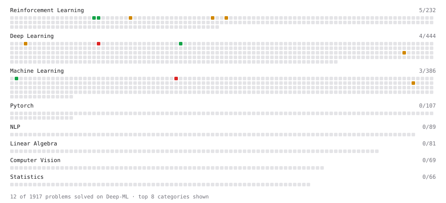

# Deep-ML

My machine learning practice from [Deep-ML](https://www.deep-ml.com). Every solution here was written by hand.

**13** solved · 13 problems · 0 labs · 0 math

[**Browse the interactive portfolio**](https://khushal-san.github.io/deep-ml/) to replay this filling in over time.

## Problems

| | Difficulty | Solved | |
| --- | --- | --- | --- |
| [Compute Multi-class Cross-Entropy Loss](https://www.deep-ml.com/problems/134) | easy | 2026-11-06 | [solution](problems/0134-compute-multi-class-cross-entropy-loss) |
| [Group Relative Advantage for GRPO](https://www.deep-ml.com/problems/224) | easy | 2026-10-20 | [solution](problems/0224-group-relative-advantage-for-grpo) |
| [KL Divergence Estimator for GRPO](https://www.deep-ml.com/problems/225) | easy | 2026-10-20 | [solution](problems/0225-kl-divergence-estimator-for-grpo) |
| [Linear Regression Using Gradient Descent](https://www.deep-ml.com/problems/15) | easy | 2026-11-05 | [solution](problems/0015-linear-regression-using-gradient-descent) |
| [Backpropagation Gradients for a Dense Layer](https://www.deep-ml.com/problems/1076) | medium | 2026-11-06 | [solution](problems/1076-backpropagation-gradients-for-a-dense-layer) |
| [Fine-Tune Model Weights with RLHF Policy Gradient](https://www.deep-ml.com/problems/361) | medium | 2026-10-20 | [solution](problems/0361-fine-tune-model-weights-with-rlhf-policy-gradient) |
| [Implement Layer Normalization for Sequence Data](https://www.deep-ml.com/problems/109) | medium | 2026-11-06 | [solution](problems/0109-implement-layer-normalization-for-sequence-data) |
| [Log-Probability Ratio for Token Sequences](https://www.deep-ml.com/problems/489) | medium | 2026-10-20 | [solution](problems/0489-log-probability-ratio-for-token-sequences) |
| [Mini-Batch Gradient Descent Step for Linear Regression](https://www.deep-ml.com/problems/803) | medium | 2026-11-06 | [solution](problems/0803-mini-batch-gradient-descent-step-for-linear-regression) |
| [PPO Clipped Surrogate Loss with Clip Diagnostics](https://www.deep-ml.com/problems/485) | medium | 2026-10-20 | [solution](problems/0485-ppo-clipped-surrogate-loss-with-clip-diagnostics) |
| [Single Neuron with Backpropagation](https://www.deep-ml.com/problems/25) | medium | 2026-11-05 | [solution](problems/0025-single-neuron-with-backpropagation) |
| [Implement Multi-Head Attention](https://www.deep-ml.com/problems/94) | hard | 2026-11-06 | [solution](problems/0094-implement-multi-head-attention) |
| [Train Logistic Regression with Gradient Descent](https://www.deep-ml.com/problems/106) | hard | 2026-11-05 | [solution](problems/0106-train-logistic-regression-with-gradient-descent) |

---

_This file is regenerated by Deep-ML on every push._
