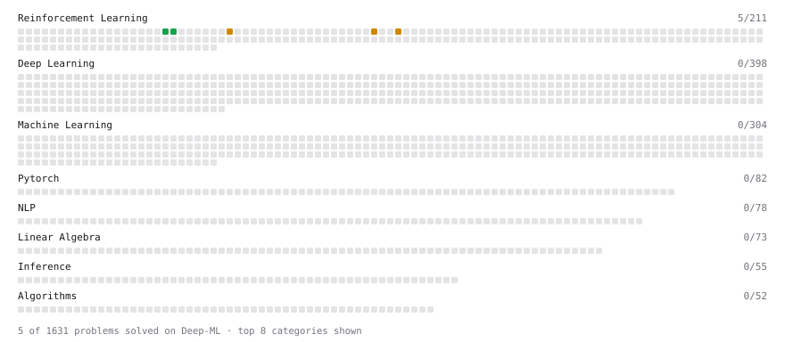

# Deep-ML

My machine learning practice from [Deep-ML](https://www.deep-ml.com). Every solution here was written by hand.

**5** solved · 5 problems · 0 labs · 0 math

[**Browse the interactive portfolio**](https://khushal-san.github.io/deep-ml/) to replay this filling in over time.

## Problems

| | Difficulty | Solved | |
| --- | --- | --- | --- |
| [Group Relative Advantage for GRPO](https://www.deep-ml.com/problems/224) | easy | 2026-10-20 | [solution](problems/0224-group-relative-advantage-for-grpo) |
| [KL Divergence Estimator for GRPO](https://www.deep-ml.com/problems/225) | easy | 2026-10-20 | [solution](problems/0225-kl-divergence-estimator-for-grpo) |
| [Fine-Tune Model Weights with RLHF Policy Gradient](https://www.deep-ml.com/problems/361) | medium | 2026-10-20 | [solution](problems/0361-fine-tune-model-weights-with-rlhf-policy-gradient) |
| [Log-Probability Ratio for Token Sequences](https://www.deep-ml.com/problems/489) | medium | 2026-10-20 | [solution](problems/0489-log-probability-ratio-for-token-sequences) |
| [PPO Clipped Surrogate Loss with Clip Diagnostics](https://www.deep-ml.com/problems/485) | medium | 2026-10-20 | [solution](problems/0485-ppo-clipped-surrogate-loss-with-clip-diagnostics) |

---

_This file is regenerated by Deep-ML on every push._
